<div align="center">

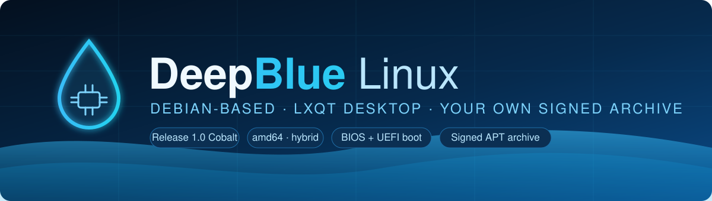

**A Deepin-inspired, Debian-based Linux distribution you actually own — its own identity packages, its own signed APT archive, its own release.**

[](#-release)
[](https://github.com/NSKWeb/deepblue-linux/releases/latest)
[](#-what-you-get)
[](#-what-you-get)
[](#-release)
[](#-release)

</div>

---

## 📥 Download &amp; run

### 1. Get the ISO

Download the latest image from the **[Releases page](https://github.com/NSKWeb/deepblue-linux/releases/latest)**:

**`DeepBlue-Linux-1.0-amd64.iso`** — ~1.86 GB (`1,997,537,280` bytes; live + installer)

Or from the command line:

```sh
curl -L -O https://github.com/NSKWeb/deepblue-linux/releases/download/v1.0/DeepBlue-Linux-1.0-amd64.iso
curl -L -O https://github.com/NSKWeb/deepblue-linux/releases/download/v1.0/DeepBlue-Linux-1.0-amd64.iso.sha256
```

### 2. Verify the download (recommended)

```sh
sha256sum -c DeepBlue-Linux-1.0-amd64.iso.sha256
# expected: DeepBlue-Linux-1.0-amd64.iso: OK
```

The expected hash is `771fbb0209c5f0a77f654aef524be1d69b5119ea9332afd4a09e5b514aa7a7bf`.

### 3. Flash it to a USB stick

Use a stick of **4 GB or larger** — everything on it will be erased.

<table>
<tr><th align="left">OS</th><th align="left">Command</th></tr>
<tr><td><b>Linux / macOS</b></td><td>

```sh
sudo dd if=DeepBlue-Linux-1.0-amd64.iso of=/dev/sdX bs=4M status=progress oflag=sync
```

(Replace `/dev/sdX` with your USB device — check with `lsblk`. On macOS use `/dev/rdiskN`.)

</td></tr>
<tr><td><b>Windows</b></td><td>Use <a href="https://rufus.ie">Rufus</a> or <a href="https://etcher.balena.io">balenaEtcher</a>: select the ISO, select the USB stick, press Start. Choose “DD image” mode in Rufus if prompted.</td></tr>
</table>

### 4. Boot from the USB stick

1. Plug the stick into the machine and **reboot**.
2. Open the **boot menu** — usually `F12`, `F10`, `F9`, `Esc`, or `Del` during the splash.
3. Pick the USB entry. On a **UEFI** machine you can leave **Secure Boot enabled** — the image is signed through Debian's Microsoft-signed `shim` (see [Secure Boot](docs/SECURE-BOOT.md)).

The boot menu offers three ways in:

| Entry | What it does |
| --- | --- |
| **Live system** | Boots the full desktop without touching your disk — auto-logs into LXQt. |
| **Start installer** | Launches the Debian installer (graphical or textual) to install DeepBlue to disk. |
| **Live system (failsafe)** | Live boot with conservative kernel options, if the normal one has trouble. |

> [!NOTE]
> The live session logs in automatically as **`deepblue`** (password `live`, member of `sudo`). Nothing is written to your disk until you run the installer.

### 5. Try it in a virtual machine (no USB needed)

Any of these work — give it **2 GB RAM** and **20 GB disk**:

<table>
<tr><th align="left">Tool</th><th align="left">How</th></tr>
<tr><td><b>QEMU (Linux/macOS)</b></td><td>

```sh
qemu-system-x86_64 -m 2048 -smp 2 -enable-kvm \
  -cdrom DeepBlue-Linux-1.0-amd64.iso -boot d
```

(drop `-enable-kvm` on macOS/Windows; it will run under TCG)

</td></tr>
<tr><td><b>VirtualBox</b></td><td>New VM → Linux / Debian 64-bit → attach the ISO as the optical disk → Start.</td></tr>
<tr><td><b>VMware / Hyper-V</b></td><td>New VM → attach the ISO → boot. UEFI or BIOS both work.</td></tr>
</table>

### 6. Install to disk

From the live session, double-click **Install DeepBlue** on the desktop (or pick **Start installer** at the boot menu), then follow the Debian installer: language → location → keyboard → disk → user → install. The guided partitioning is **encrypted (LUKS2) by default** — you will be asked for a disk passphrase; choose a strong one, because it is the only thing standing between a stolen laptop and your files, and there is no recovery key unless you make one. On first boot you get the installed DeepBlue system, which updates from its own signed archive and has the firewall, auto-updates and AppArmor switched on (see [Security](#-security--what-is-on-and-what-is-not)).

---

## Why this exists

Most “make your own distro” advice stops at a wallpaper and an `os-release`
file. DeepBlue goes the full distance and does what real derivatives — Ubuntu,
Linux Mint, Kali, and Deepin itself — do:

- ships its **identity as a real Debian package** that **diverts** the copies
  from `base-files`, so a Debian upgrade can never silently overwrite the
  branding;
- builds its **own signed APT archive** with its own GPG key, so only you can
  publish packages your systems will trust;
- wires that archive into the ISO, so an **installed** DeepBlue system updates
  from its own repository.

DeepBlue is a *rebrand* of the Debian live system, not a from-scratch distro.
Deepin is built the same way (Debian base + its own desktop), so this is the
same approach taken to a smaller, reproducible scale.

---

## What you get

<table>
<tr><th align="left">Layer</th><th align="left">Choice</th><th align="left">Why</th></tr>
<tr><td><b>Base</b></td><td>Debian GNU/Linux 13 (trixie), <code>amd64</code></td><td>Stable, huge package set, the same base Deepin uses</td></tr>
<tr><td><b>Desktop</b></td><td>LXQt (Qt6) + Kvantum <code>DeepBlue</code> theme</td><td>Closest stock-Debian equivalent to Deepin’s DDE look &amp; feel</td></tr>
<tr><td><b>Icons / cursor</b></td><td>Papirus-Dark · Bibata-Modern-Ice</td><td>Modern, consistent, Deepin-adjacent</td></tr>
<tr><td><b>GTK theme</b></td><td>Arc-Dark</td><td>Dark GTK apps match the Qt theme</td></tr>
<tr><td><b>Shell</b></td><td>Top LXQt panel + bottom Plank dock</td><td>Deepin’s top-bar / bottom-dock layout</td></tr>
<tr><td><b>Boot splash</b></td><td>DeepBlue Plymouth theme</td><td>Branded boot, no stock logo</td></tr>
<tr><td><b>Display manager</b></td><td>LightDM with slick-greeter</td><td>Themeable, auto-login friendly</td></tr>
<tr><td><b>Boot</b></td><td>Hybrid ISO — BIOS + UEFI</td><td>One image boots on anything</td></tr>
<tr><td><b>Installer</b></td><td>Debian installer, graphical + textual</td><td>Install to disk, not just live</td></tr>
<tr><td><b>Live user</b></td><td><code>deepblue</code> (password <code>live</code>, in <code>sudo</code>)</td><td>Deepin-live style, no friction</td></tr>
<tr><td><b>Auto-login</b></td><td>Straight into the LXQt desktop</td><td>No login prompt on the live session</td></tr>
</table>

---

## 🖥️ How a session boots — and the login model

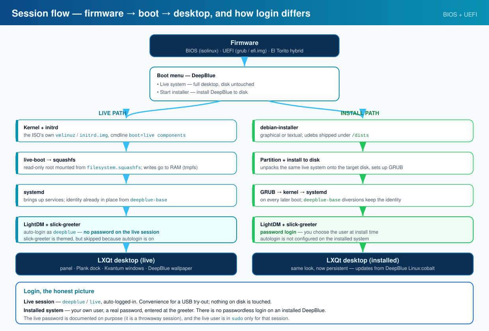

The diagram above follows one boot from firmware to desktop. There are **two
paths**, and they differ in exactly one place — the login.

**Live path.** Firmware (BIOS `isolinux` or UEFI `grub`) reads the boot menu →
the live kernel and initrd load → `live-boot` mounts the read-only squashfs over
a RAM `tmpfs` → `systemd` starts services → **LightDM with slick-greeter** →
because auto-login is on, the greeter is skipped and you land in LXQt as
`deepblue`. Nothing on your disk is written.

**Install path.** You pick *Start installer* → `debian-installer` (graphical or
textual) partitions the disk and unpacks the same system onto it → on every
later boot GRUB → kernel → `systemd` → **LightDM**, and this time you type your
own password at the greeter.

### The login model, stated plainly

| Session | Account | Password | Why |
|---|---|---|---|
| **Live ISO** | `deepblue` | `live` — auto-logged-in | A USB try-out must be frictionless; the session is throwaway and never touches disk |
| **Installed system** | the user *you* create at install time | **your own password**, entered every boot | A real machine must not be open to anyone who walks up to it |

> [!IMPORTANT]
> **There is no passwordless login on an installed DeepBlue.** Auto-login is
> configured for the live session only. Once you install to disk, LightDM
> (`slick-greeter`) asks for your user's password on every boot — so a stranger
> with physical access cannot walk into your desktop.
>
> The live password is documented on purpose: it is a disposable session, and
> the live user is in `sudo` *for that session only*. It is not carried onto an
> installed system.

If you *want* auto-login on your own installed machine, that is a deliberate
one-line change you make yourself (`autologin-user=` in
`/etc/lightdm/lightdm.conf`) — off by default, never forced on.

---

## 🎨 Deepin-style theming

DeepBlue ships a coherent, dark, blue-accented desktop — not stock LXQt.

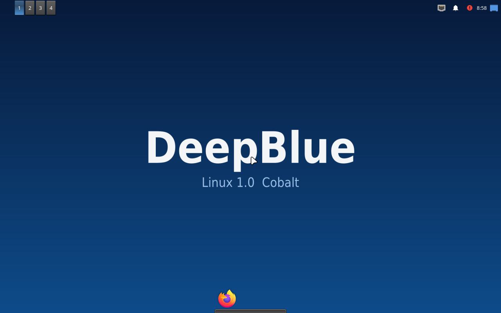

> **Interactive preview:** open [`docs/preview.html`](docs/preview.html) in a browser for a full walk-through of the desktop, boot splash, colour system and specs — no download needed.

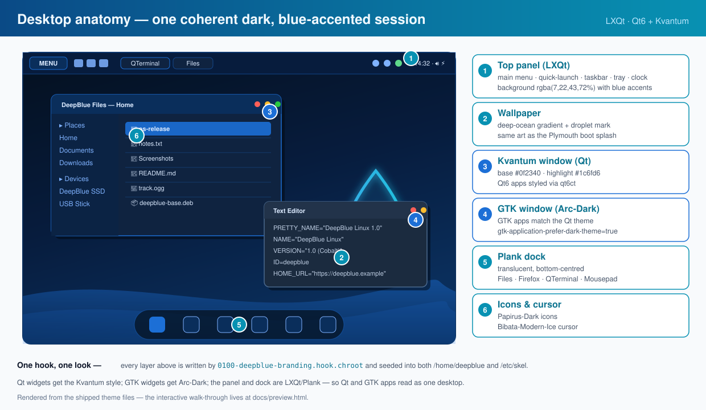

*Every layer above is written by a single chroot hook and seeded into both
`/home/deepblue` and `/etc/skel` — see the callouts. The point of the pairing is
that **Qt and GTK apps read as one desktop**: Kvantum styles the Qt widgets,
Arc-Dark styles the GTK widgets, and both draw from the same palette.*

| Piece | What it is |
|---|---|
| **Qt widget style** | Kvantum `DeepBlue` theme (recolored KvArcDark: highlight `#1c6fd6`, base `#0f2340`), selected via `qt6ct`/`qt5ct` |
| **LXQt theme** | `DeepBlue` (panel background `rgba(7,22,43,72%)`, blue accents) |
| **Icons** | Papirus-Dark |
| **Cursor** | Bibata-Modern-Ice (only the used variant ships; the rest are trimmed to stay under the 2 GB release limit; ISO ships at ~1.86 GB) |
| **GTK apps** | Arc-Dark, `gtk-application-prefer-dark-theme=true` |
| **Panel** | LXQt panel on top — main menu, desktop switcher, taskbar, tray, volume, clock |
| **Dock** | Plank on the bottom, translucent, seeded with Files · Firefox · QTerminal · Mousepad |
| **Compositor** | picom (fading + inactive-opacity) for the translucent dock |
| **Login** | slick-greeter with the DeepBlue wallpaper, Arc-Dark, auto-login |
| **Boot splash** | DeepBlue Plymouth theme (deep-blue gradient, pulsing logo, progress bar) |

All of it lives in one hook — `config/hooks/live/0100-deepblue-branding.hook.chroot` —
plus the theme directories under `config/includes.chroot/usr/share/{Kvantum,lxqt,plymouth}`.
Per-user defaults are seeded into both `/home/deepblue` and `/etc/skel`.

---

## 🌊 The design language — “deep ocean”

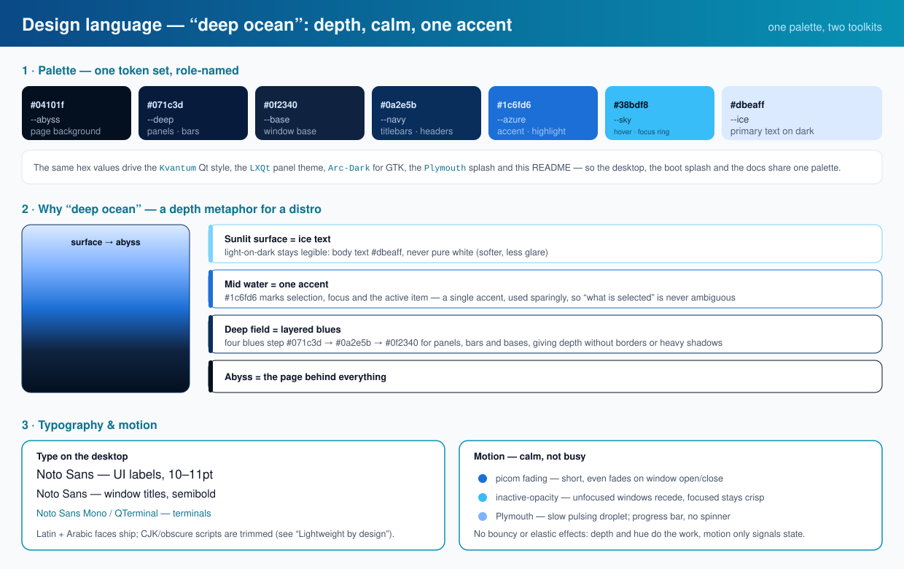

The look is not a random dark theme. It has a name — **deep ocean** — and a small
set of rules that everything follows, from the boot splash to this page.

**One palette, role-named.** Eight tokens carry every surface and every accent:

| Token | Hex | Role |
|---|---|---|
| `--abyss` | `#04101f` | the page / desktop behind everything |
| `--deep` | `#071c3d` | panels and bars |
| `--base` | `#0f2340` | window base |
| `--navy` | `#0a2e5b` | titlebars and headers |
| `--azure` | `#1c6fd6` | **the** accent — selection, focus, active item |
| `--sky` | `#38bdf8` | hover and focus rings |
| `--ice` | `#dbeaff` | primary text on dark |
| `--muted` | `#8fa9cf` | secondary text |

**Depth instead of borders.** Four blues step from surface to abyss, so panels,
bars and window bases separate by *hue and darkness*, not by hard 1px borders or
heavy drop-shadows. That is why the desktop feels calm and layered rather than
flat.

**One accent, used sparingly.** `--azure` marks exactly one thing at a time — the
selected row, the focused control, the active task. Because it is the only strong
colour, “what is selected” is never ambiguous.

**Type and motion.** Noto Sans for the UI (Latin + Arabic ship; CJK/obscure
scripts are trimmed — see the next section). Motion is calm: picom fading,
inactive-window opacity, and a slow pulsing droplet on the Plymouth splash.
No bounce, no elastic — depth and hue do the work, motion only signals state.

Because the palette is shared, the **Kvantum** Qt style, the **LXQt** panel
theme, **Arc-Dark** for GTK, the **Plymouth** splash and the docs all match by
construction, not by hand-tuning each one.

---

## 🪶 Lightweight by design

The same hook trims the image so it stays comfortably under GitHub's 2 GB release
limit (~1.86 GB) without removing anything a desktop user needs:

| Trim | Saves | Why it is safe |
|---|---|---|
| APT package lists + caches (`/var/lib/apt/lists`, `/var/cache/apt`) | ~200 MB | Regenerated by `apt update` |
| CJK Noto fonts (`NotoSansCJK`, `NotoSerifCJK`) | ~92 MB | Desktop ships Latin + Arabic |
| Obscure-script Noto faces (SignWriting, Tangut, Cuneiform) | ~9 MB | No UI renders them |
| Legacy X11 bitmap/Type1 fonts | ~22 MB | Fontconfig + TrueType cover modern toolkits |
| `Papirus-Light` icon variant | ~15 MB | Only `Papirus-Dark` is selected |
| Documentation bodies (keeps each `copyright`) | ~53 MB | Licence files retained |
| Unused Bibata cursor variants | ~144 MB | Only `Bibata-Modern-Ice` is selected |
| `netronome` firmware | ~2 MB | Enterprise NIC no desktop has |

`loadlin` (a legacy DOS boot loader) is disabled in `build.sh` (`--loadlin false`),
since the ISO already boots via BIOS `isolinux` and UEFI `grub`.

---

## Architecture

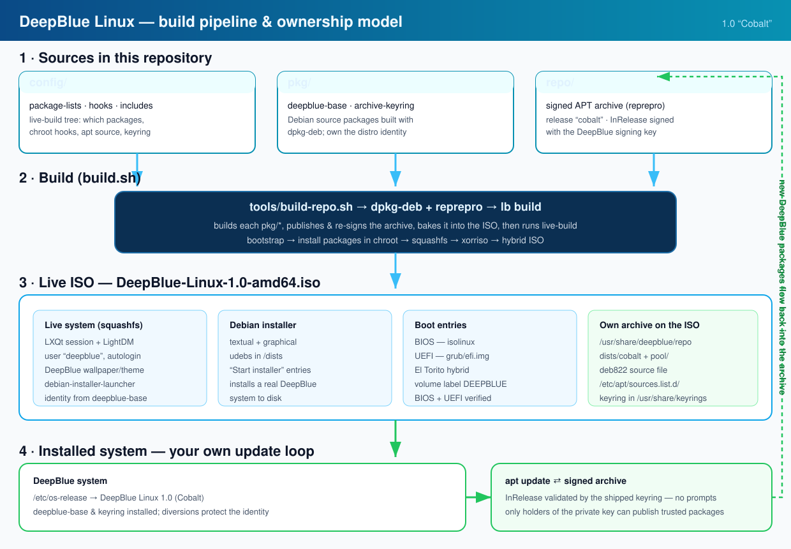

The pipeline is short and reproducible. `build.sh` runs four things:

1. **`tools/build-repo.sh`** builds every source package under `pkg/` with
   `dpkg-deb`, publishes it into the reprepro archive under `repo/`, and
   **re-signs the archive indices** with the DeepBlue signing key.
2. It copies the signed archive into `config/includes.chroot/usr/share/deepblue/repo`
   so the ISO **ships its own repository**, plus the keyring into
   `/usr/share/keyrings/`.
3. `lb config` sets the live-build parameters (distribution, arch, installer,
   ISO metadata, live user).
4. `lb build` bootstraps the chroot, installs packages, squashfs-es the live
   system and produces a **hybrid ISO** with both BIOS and UEFI boot records.

On an installed system the loop closes: `apt update` validates the archive’s
`InRelease` against the shipped keyring, and `deepblue-base` updates come
straight from `DeepBlue Linux:cobalt`.

### Inside the ISO

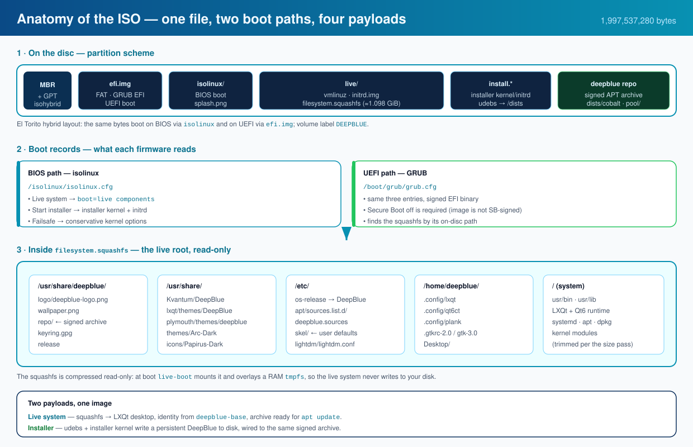

One file carries everything. The ISO is **El Torito hybrid**, so the same bytes
boot on BIOS (via `isolinux`) and UEFI (via `efi.img`), with volume label
`DEEPBLUE`. On the disc:

| Region | What it holds |
|---|---|
| `efi.img` / `isolinux/` | the two boot paths and their menus |
| `live/` | `vmlinuz`, `initrd.img`, and `filesystem.squashfs` (≈1.098 GiB) |
| `install.*` | the installer kernel, initrd and udebs |
| `deepblue repo` | the signed APT archive, shipped on the image |

At boot `live-boot` mounts the **read-only squashfs** and overlays a RAM
`tmpfs`, so the live system never writes to your disk. The squashfs already
contains the branded theme directories, the `deepblue-base` identity, the APT
source file and the archive itself — which is why the live session can run
`apt update` before anything is installed.

---

## Ownership — the honest picture

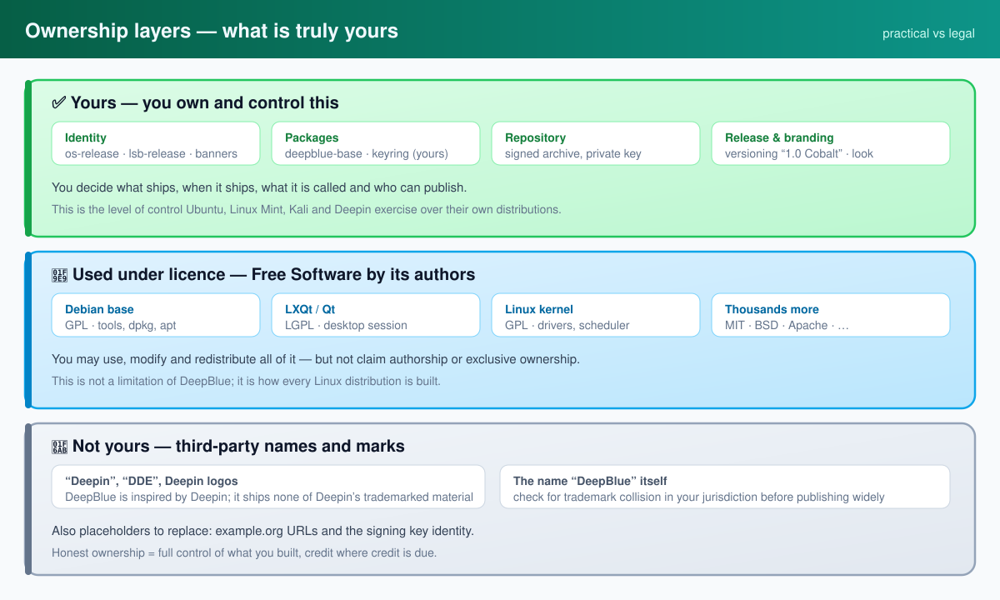

“Ownership” has two meanings, and it is worth being precise:

| | Meaning | Reality for DeepBlue |
|---|---|---|
| ✅ **Practical** | Who controls the distribution: identity, packages, repository, release | **Yours.** You decide what ships, when, its name, and who may publish. |
| 🧩 **Licence** | The underlying Debian/LXQt/kernel code | Owned by its authors under GPL/LGPL/MIT/BSD. You may use, modify, redistribute — **not** claim authorship. |
| 🚫 **Trademark** | “Deepin”, “DDE”, Deepin logos | Belong to Deepin Technology / the Deepin community. DeepBlue is *inspired by* Deepin and ships none of its marks. |

Practical ownership is exactly what Ubuntu, Mint, Kali and Deepin exercise.
Full legal ownership of the Free Software stack is not something any
distribution has — and claiming it would be inaccurate and a licence
violation. See [`docs/OWNERSHIP.md`](docs/OWNERSHIP.md).

---

## Packages — the identity is code, not files

DeepBlue’s branding lives in **real Debian packages**, built from source in
[`pkg/`](pkg/):

| Package | Purpose |
| --- | --- |
| [`deepblue-base`](pkg/deepblue-base) | Owns `/etc/os-release`, `/etc/lsb-release`, `/etc/issue`, `/etc/issue.net`, `/etc/deepblue/release`. Diverts the `base-files`/`lsb-release` copies. |
| [`deepblue-archive-keyring`](pkg/deepblue-archive-keyring) | The public key of the DeepBlue archive. |

### Inside a package

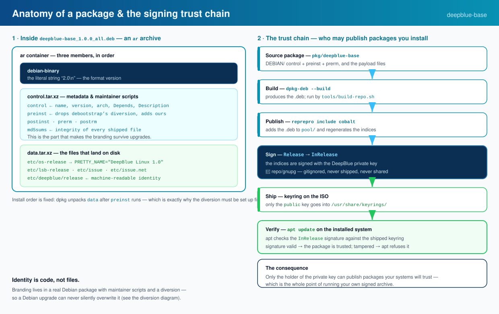

A `.deb` is an `ar` archive with three members, in order: `debian-binary` (the
format version), `control.tar.xz` (metadata and maintainer scripts) and
`data.tar.xz` (the files that land on disk). For `deepblue-base` the middle
member is the interesting one — it carries `preinst`/`prerm`, and the last
member carries `/etc/os-release` and friends. dpkg runs `preinst` *before*
unpacking `data`, which is exactly why the diversion must be set up first.

### How the branding survives upgrades

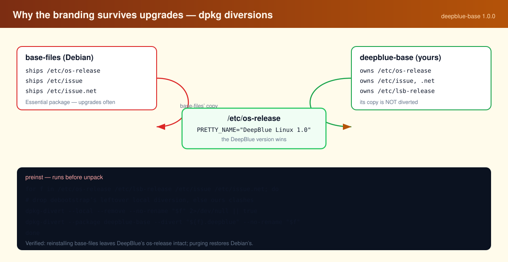

`base-files` is an *Essential* package that ships `/etc/os-release`, so a naive
`dpkg-divert --rename` fails at unpack time with
`trying to overwrite '/etc/os-release'`. Two things fix it, both in
[`pkg/deepblue-base/DEBIAN/preinst`](pkg/deepblue-base/DEBIAN/preinst):

1. **`--no-rename`** — we do not want the file moved aside, we replace its
   contents.
2. debootstrap leaves a *local* diversion on `/etc/os-release`
   (`→ /etc/os-release.debootstrap`) that clashes with ours; the `preinst`
   drops it first and **must pass `--local`**, otherwise dpkg scopes the
   removal to the package and errors `mismatch on package`.

The `prerm` mirrors the `preinst` exactly. The result is verified behaviour:

| Action | `/etc/os-release` after |
| --- | --- |
| Install `deepblue-base` | `PRETTY_NAME="DeepBlue Linux 1.0"` |
| Reinstall `base-files` | **still DeepBlue** — the upgrade cannot clobber it |
| Purge `deepblue-base` | Debian’s original, diversions cleanly removed |

---

## The signed archive

`repo/` is a [reprepro](https://salsa.debian.org/brlink/reprepro) archive,
release codename **`cobalt`**, whose indices (`InRelease`, `Release.gpg`) are
signed with the DeepBlue key. On the ISO it is wired in with a `deb822`
source:

```ini
# /etc/apt/sources.list.d/deepblue.sources
Types: deb
URIs: file:///usr/share/deepblue/repo
Suites: cobalt
Components: main
Signed-By: /usr/share/keyrings/deepblue-archive-keyring.gpg
```

> [!IMPORTANT]
> The **private signing key** lives in `repo/gnupg/` and is **gitignored —
> never commit or share it.** It is the one thing that lets you publish
> packages your systems will trust. To host the archive over HTTP later, copy
> `repo/apt/` to a web root and point the `URIs:` field at your URL.

---

## 🔐 Security — what is on, and what is not

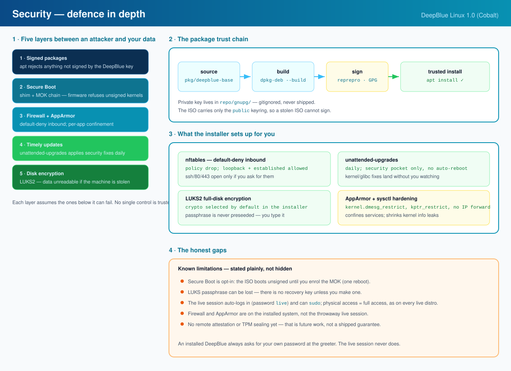

DeepBlue treats security as **defence in depth**: several independent layers,
each assuming the ones below it can fail. Nothing here is a from-scratch
invention — it is Debian's own tooling, configured and switched on by default
so you do not have to.

### The layers, top to bottom

| Layer | What it does | Where it lives |
| --- | --- | --- |
| **Signed packages** | `apt` refuses any package not signed by the DeepBlue key | [`repo/`](repo/) · `deepblue-archive-keyring` |
| **Secure Boot** | Firmware refuses an unsigned bootloader/kernel — enabled via Debian's signed `shim` | [`build.sh`](build.sh) · [`docs/SECURE-BOOT.md`](docs/SECURE-BOOT.md) |
| **Firewall + AppArmor** | Default-deny inbound traffic; per-program confinement | [`pkg/deepblue-security`](pkg/deepblue-security) |
| **Timely updates** | Debian security fixes install themselves, daily | [`pkg/deepblue-security`](pkg/deepblue-security) |
| **Disk encryption** | A stolen machine's disk is unreadable | [`config/includes.installer/preseed.cfg`](config/includes.installer/preseed.cfg) |

### 1 · Default-deny firewall (nftables)

The `deepblue-security` package ships a short, readable nftables policy at
`/etc/nftables.conf`. **Inbound is dropped unless explicitly allowed**;
loopback, replies to connections you opened, and ICMP (needed for path-MTU
discovery) are the only things let through by default. SSH, mDNS and web ports
are present as commented one-liners you uncomment if you actually run them.
Forwarding is dropped too — this is a workstation, not a router.

The package **diverts** nftables' own `/etc/nftables.conf`, the same
`dpkg-divert` trick `deepblue-base` uses for `/etc/os-release`, so a Debian
upgrade cannot silently restore the permissive default.

### 2 · Automatic security updates

`unattended-upgrades` is enabled with a policy that accepts **only the Debian
security pocket** — vulnerability fixes, not unrelated version churn. Reboots
are never forced; a kernel or glibc update waits for a reboot you choose.

### 3 · AppArmor + kernel hardening

AppArmor is installed and enabled, and a conservative `sysctl.d` profile
closes the usual information leaks and attack surfaces: `dmesg` and kernel
pointers restricted to root, unprivileged eBPF and perf restricted, IP
forwarding off, ICMP redirects ignored, reverse-path filtering on, unprivileged
user namespaces off. Every setting is desktop-safe — nothing here breaks a
normal session.

### 4 · Full-disk encryption by default

The installer's preseed selects **encrypted LVM (LUKS2)** as the guided
partitioning method, so the default path through "Install DeepBlue" produces an
encrypted disk. The passphrase is **never** preseeded — you are asked for it,
and only you know it. (Preseeding a disk passphrase would store it in plaintext
on the ISO, which defeats the point.)

### 5 · Secure Boot — on by default

The 1.0 ISO boots **with Secure Boot enabled** on UEFI machines. live-build's
EFI stage puts Debian's Microsoft-signed `shim` at `EFI/BOOT/BOOTX64.EFI` and
Debian-signed GRUB behind it, so the firmware's default trust in Microsoft's
UEFI CA is enough to boot DeepBlue — no trip to the firmware setup menu. The
build guarantees this: `build.sh` passes `--uefi-secure-boot enable`, which
fails the build rather than silently shipping an unsigned image.

The honest caveat: the chain terminates in **Debian's** key, not DeepBlue's.
That is the correct trade for a Debian-based distro, but it means a
*DeepBlue-built* custom kernel needs a Machine Owner Key to be trusted — the
next step, and a full own-shim route (with an EV certificate) after that. All
three routes, and what Secure Boot does and does not protect against, are in
[`docs/SECURE-BOOT.md`](docs/SECURE-BOOT.md).

> [!NOTE]
> These controls live on the **installed** system. The live session is a
> throwaway, auto-logged-in, `sudo`-capable environment by design — as on every
> live distro, physical access to it is full access. Install to get the
> hardening, and set a real password at the greeter.

---

## Verified behaviour

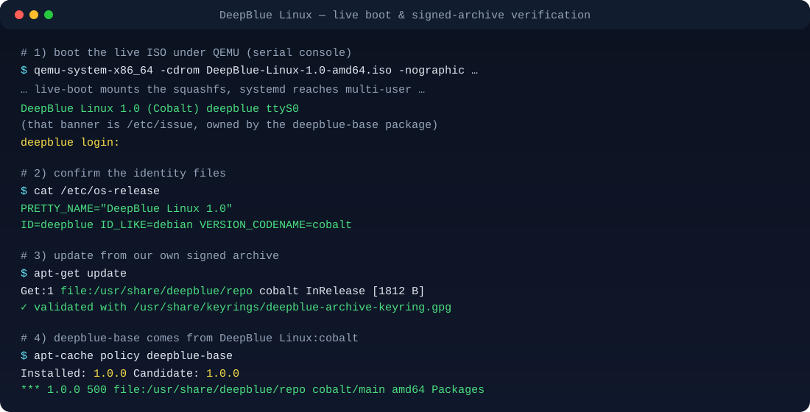

Everything below was exercised on the built image (evidence in [`docs/`](docs/)):

- [x] Live ISO **boots** under QEMU (TCG) — banner `DeepBlue Linux 1.0 (Cobalt)`, `deepblue login:`
- [x] **Auto-login** into the LXQt graphical session
- [x] Debian **installer** boots (textual + graphical) — language → location → keyboard → hardware → network
- [x] `deepblue-base` **installs cleanly** in the chroot
- [x] `apt-get update` validates the archive’s `InRelease` with the shipped keyring — no prompts, no errors
- [x] `apt-cache policy deepblue-base` → candidate from **`DeepBlue Linux:cobalt`**
- [x] `base-files` reinstall leaves the DeepBlue identity intact; purge restores Debian’s
- [x] **Size-trimmed ISO still boots** — APT caches, CJK/legacy fonts, `Papirus-Light` and unused cursor variants removed, yet the live session reaches the same `deepblue login:` banner (evidence: [`docs/boot-trim-evidence.log`](docs/boot-trim-evidence.log))

---

## Release

| Property | Value |
| --- | --- |
| Version | **1.0 “Cobalt”** |
| File | `DeepBlue-Linux-1.0-amd64.iso` |
| Size | ~1.86 GB (live + installer) |
| Volume label | `DEEPBLUE` |
| Boot records | El Torito **BIOS** (`isolinux`) + **UEFI** (`grub`) |
| Secure Boot | **Enabled** — Debian-signed `shim` + GRUB |
| Live user | `deepblue` / `live` |
| Hostname | `deepblue` |

The built ISO is intentionally **not** committed to git (it is large); it is
published as a **release asset** and is fully reproducible from this source.

**[Download the latest ISO](https://github.com/NSKWeb/deepblue-linux/releases/latest)** ·
[all releases](https://github.com/NSKWeb/deepblue-linux/releases) ·
[how to flash &amp; boot](#-download--run)

---

## Repository layout

```text
config/                                   # live-build tree
  package-lists/deepblue.list.chroot      # packages installed into the live system
  package-lists/installer.list.chroot     # debian-installer-launcher
  packages.chroot/                        # local .deb files baked into the ISO
  hooks/live/0100-deepblue-branding.hook.chroot
                                          # chroot hook: session, wallpaper,
                                          # welcome message, display manager
  includes.chroot/etc/apt/sources.list.d/deepblue.sources
  includes.chroot/usr/share/deepblue/repo # the signed archive, shipped on the ISO
  includes.chroot/usr/share/keyrings/deepblue-archive-keyring.gpg
  includes.chroot/usr/share/backgrounds/deepblue/wallpaper.png
  includes.chroot/usr/share/deepblue/logo/deepblue-logo.png
  includes.binary/isolinux/splash.png     # BIOS boot splash
  includes.installer/preseed.cfg          # installer defaults: LUKS encryption,
                                          #   no root login, deepblue-* packages
pkg/                                      # Debian source packages (yours)
  deepblue-base/                          # distribution identity
  deepblue-archive-keyring/               # archive public key
  deepblue-security/                      # nftables, auto-updates, AppArmor,
                                          #   sysctl hardening
repo/                                     # signed APT archive (reprepro)
  apt/conf/distributions                  # release "cobalt"
  apt/dists/cobalt/                       # signed indices
  apt/pool/                               # package files
  deepblue-archive-keyring.gpg            # public key
  gnupg/                                  # private signing keyring (GITIGNORED)
tools/build-repo.sh                       # build + publish + sign packages
build.sh                                  # configure + build the ISO
setup-host.sh                             # install toolchain + container workaround
docs/                                     # evidence, ownership notes, SVG assets,
  assets/hero.svg                         #   banner
  assets/architecture.svg                 #   build pipeline + ownership model
  assets/session-flow.svg                 #   firmware → boot → desktop, login paths
  assets/desktop-anatomy.svg              #   annotated LXQt desktop
  assets/design-system.svg                #   palette, depth, type, motion
  assets/iso-anatomy.svg                  #   hybrid ISO layout + squashfs zoom
  assets/package-anatomy.svg              #   .deb members + signing trust chain
  assets/security.svg                     #   defence-in-depth layers + gaps
  assets/ownership.svg · diversion.svg    #   ownership layers · dpkg diversion
  assets/terminal-flow.svg                #   verified boot/apt transcript
  SECURE-BOOT.md                          #   shim / MOK / Microsoft signing plan
  preview.html                            #   browsable desktop preview
```

---

## Building

Requires a Debian (or Debian-derived) host, root (live-build mounts
`/proc`, `/dev/pts`, `/sys` inside the chroot), and ~60 GB free disk.

```sh
sudo apt-get install live-build debootstrap xorriso squashfs-tools \
     gpg reprepro qemu-system-x86
sudo ./setup-host.sh      # installs the toolchain and applies the sysfs workaround
sudo ./build.sh           # builds packages + signs the archive + builds the ISO
```

On a 4-vCPU QEMU/TCG sandbox: first build ~12.5 min, warm rebuild ~8.5 min,
with the installer ~12 min.

---

## Verification

Boot the ISO under QEMU (no KVM in this sandbox, so TCG — slow):

```sh
qemu-system-x86_64 -m 2048 -smp 2 -nographic -no-reboot \
  -cdrom live-image-amd64.hybrid.iso \
  -kernel <extracted vmlinuz> -initrd <extracted initrd.img> \
  -append "boot=live components hostname=deepblue username=deepblue console=ttyS0,115200"
```

The live user password is `live`. Evidence logs live in [`docs/`](docs/).

---

## Roadmap

- [ ] Host the signed archive over HTTPS and point the source at it
- [x] Deepin-style theming pass (Kvantum Qt style, Papirus-Dark icons, top panel + Plank dock, slick-greeter, Plymouth splash)
- [x] Interactive desktop preview page ([`docs/preview.html`](docs/preview.html))
- [x] Keep the ISO under GitHub's 2 GB release limit (~1.86 GB) with a documented trim pass
- [x] Security defaults: default-deny nftables firewall, automatic security updates, AppArmor, kernel hardening, encrypted-disk installer default
- [x] Secure Boot: boot with Secure Boot enabled via Debian's Microsoft-signed `shim` (Option A in [`docs/SECURE-BOOT.md`](docs/SECURE-BOOT.md))
- [ ] Secure Boot: MOK flow for self-built kernels (Option B)
- [ ] Custom installer branding
- [ ] A `deepblue-meta` metapackage to pull in the default desktop set

---

<div align="center">

**DeepBlue Linux** — built with Debian’s [`live-build`](https://wiki.debian.org/DebianLive) · release **1.0 “Cobalt”**

*Practical ownership is yours; the Free Software stack is used under licence. See [`docs/OWNERSHIP.md`](docs/OWNERSHIP.md).*

</div>
